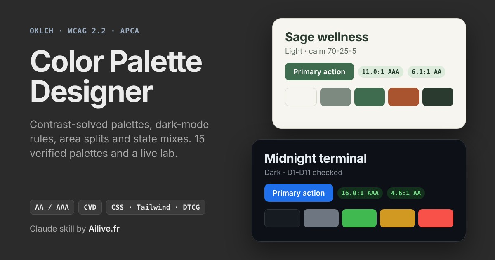
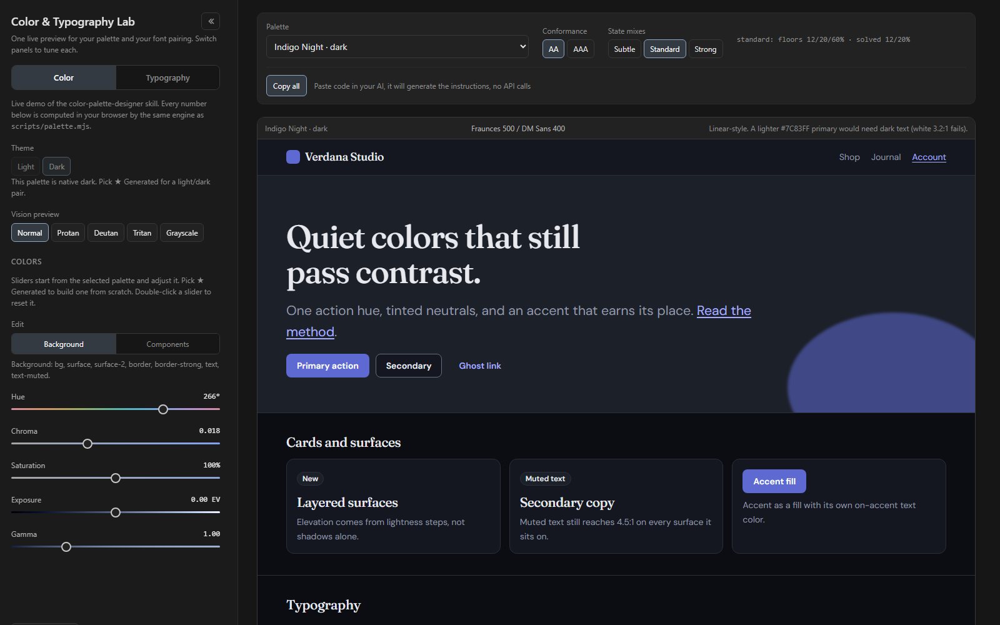
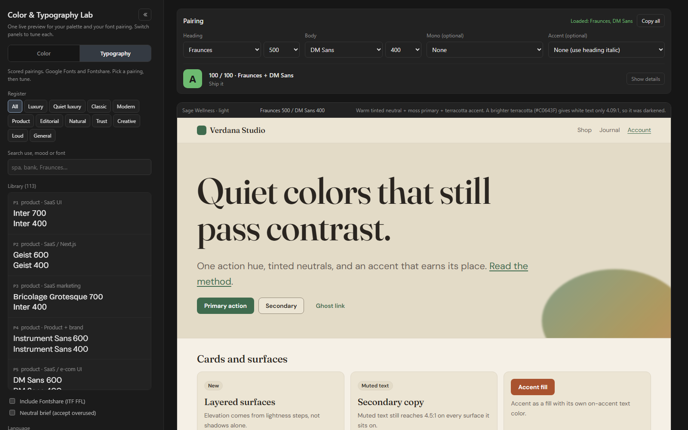

<p align="center"></p>

# Color Palette Designer

A Claude skill that designs, validates and ships web color palettes, plus a live **Color & Typography Lab** that pairs them with scored font pairings on one shared preview. Every color is a **role** (bg, surface, text, primary, accent, semantic…), generated in **OKLCH**, solved on **lightness only** until it passes **WCAG 2.2**, then checked for APCA, color-blindness, dark-mode rules, area splits and interaction states. Output is copy-ready CSS variables, Tailwind v4 `@theme` or DTCG tokens.

**[Live demo](https://www.ailive.fr/color-palette-designer-skill/)** · [Download the skill](color-palette-designer.skill) · Created by [Ailive.fr](https://ailive.fr)

<p align="center"></p>

<p align="center"></p>

## What it does

- **Generates** light and dark palettes from a brief (brand color, mood, industry) with a 50–950 ramp, tinted neutrals, one action hue and an optional accent.
- **Solves contrast** by moving OKLCH lightness only, so hue and chroma stay put: text 4.5:1, large text and UI 3:1, AAA 7:1 on request.
- **Audits** every role pair: WCAG ratio and grade, APCA Lc (advisory, WCAG 3 has no algorithm), Machado CVD simulation with dE<sub>OK</sub> separation.
- **Dark-mode rules D1–D11** (not pure black, no pure white text, elevation by lightness, semantic colors readable on raised surfaces…). FAIL blocks, WARN needs a stated reason.
- **Area-split presets** (60-30-10, calm 70-25-5, dense-app 80-17-3, editorial, bold-brand…) with rules A1–A7 and a DOM sampler that measures a real page.
- **State mixes**: hover, active, disabled and tint percentages solved per palette so each step is actually visible (S1–S6), emitted as `color-mix(in oklab, …)`.
- **15 verified palettes**: wellness/organic, dark developer, SaaS, fintech, health, e-commerce, agency.
- **Lightroom-style color sliders** in the lab: hue, chroma, saturation, exposure (in stops) and gamma, each with a track that shows what it changes. A switch edits the background (neutrals) and the components (primary, accent, status) separately, and every slider starts from the colors of the selected preset.
- **Component previews** that follow the palette: color hierarchy (primary, secondary, outline, tertiary), UI states (default, hover, pressed, focused, loading, disabled) and feedback states (info, warning, success, error).
- **Font pairings** in the same lab: a library of scored pairings (Google Fonts, optional Fontshare) shown in their real fonts, a 9-point pairing check (license, x-height, width, contrast, weights, byte budget), scale ratio, line-height, tracking and measure controls, metric-matched fallbacks, and copy-ready CSS (Google link, self-host, tokens, Tailwind v4). A preview background switch (Palette, Light, Paper, Dark, Ink) tests the fonts on different surfaces.
- **One preview**: the palette sets the colors and the pairing sets the typography of the same sample UI. Switch between the **Color** and **Typography** tabs, drag or close the left menu, and technical tables stay folded until you open them.
- **Copy all**: one click copies every setting, role (hex and OKLCH), contrast result, CSS variable and a share link as a prompt. Each tab also has its own copy button (all color settings, all typography settings). Paste it in your AI and it writes the implementation instructions, no API calls.

## Install

**Claude (web, desktop):** Settings → Capabilities → Skills → upload [`color-palette-designer.skill`](color-palette-designer.skill).

**Claude Code:**

```bash
git clone https://github.com/visualife/color-palette-designer-skill
cp -r color-palette-designer-skill/color-palette-designer ~/.claude/skills/
```

Then ask for a palette, a contrast fix or a dark-mode audit:

- "Palette for a natural-wellness Shopify store, calm, light and dark."
- "My orange CTA looks washed out on white, fix it without changing the hue."
- "Audit these CSS variables for dark mode."
- "Which area split fits a dev-tool dashboard?"

## CLI

The engine is plain Node with no dependencies and runs the same code as the demo.

```bash
cd color-palette-designer
node scripts/palette.mjs contrast "#2B3A2F" "#F7F5EF"        # ratio, grade, APCA
node scripts/palette.mjs solve "#E07B39" "#FFFFFF" 4.5       # lightness-only fix
node scripts/palette.mjs generate --hue 155 --chroma .07 --format css --states standard
node scripts/palette.mjs audit sage-wellness                 # exit 1 on failure
node scripts/palette.mjs dark midnight-terminal              # D1-D11
node scripts/palette.mjs ratio 70 25 5 --preset calm         # area split
node scripts/palette.mjs states sage-wellness --css          # hover/active/tints
node scripts/palette.mjs cvd "#3F6B4E" "#A9532F"             # color-blind separation
```

`node scripts/palette.mjs` lists every command. `scripts/measure-area.js` measures a live page from DevTools. `node scripts/build_demo.mjs --palette my.json --out demo.html` rebuilds the demo with your own palette.

## The demo

[`color-palette-designer-skill.html`](color-palette-designer-skill.html) is a single dependency-free file (the Color & Typography Lab). Pick a palette, flip light/dark, edit any role color and watch the audit, state mixes and CSS update. It also has Lightroom-style sliders with a Background/Components switch, color hierarchy, UI-state and feedback previews, a Copy all button that exports every setting for an AI, a contrast checker with a nudge-to-pass button, color-blind and grayscale previews, an HSL vs OKLCH lab, CSS and DTCG downloads, a Typography tab with the font library, pairing check and CSS output, and a shareable link that stores the whole state in the URL.

## Repository

| Path | Content |
|---|---|
| `color-palette-designer/` | Skill source: `SKILL.md`, `scripts/`, `references/`, `evals/`, `assets/` |
| `color-palette-designer.skill` | Packaged skill, ready to upload |
| `color-palette-designer-skill.html` | Built single-file Color & Typography Lab (source: `color-palette-designer/assets/demo.src.html`, build: `node color-palette-designer/scripts/build_demo.mjs --out color-palette-designer-skill.html`) |
| `color-type-lab.jpg` | Social/OG image of the lab (1200×630) |
| `colorsys.jpg` | Previous OG image (1200×630) |
| `screenshot.png`, `screenshot-typography.png` | README screenshots of the Color and Typography tabs |

## Evidence

Contrast thresholds follow WCAG 2.2. Area splits are category conventions, not research: they protect the isolation effect (a CTA hue must be rare). State percentages are measured per palette. [`references/evidence-and-conventions.md`](color-palette-designer/references/evidence-and-conventions.md) separates what is standard, what is research-backed and what is convention.

---

Created by [**Ailive.fr**](https://ailive.fr): Shopify, WordPress, design, 3D, video, AI automation, SEO.
